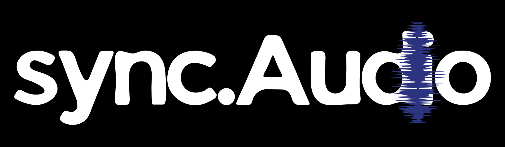

<p align="center">
  
</p>

<h1 align="center">Sync.audio</h1>

<p align="center">
  <strong>The room stays silent. Every earbud screams.</strong>
</p>

<p align="center">
  <a href="LICENSE"></a>
  
  
  
</p>

## The problem

Smart TVs — including Fire TV — allow **exactly one Bluetooth audio receiver** at a time. One soundbar or one headphone, never a room full of them. So when a group wants to watch the same screen with personal audio (late-night sports bar, dorm room, shared flat, gym wall), everyone fights over a single pairing slot or huddles around phone speakers on a video call.

**Sync.audio flips the model**: the TV (or any browser host) plays *silently*, captures its master audio locally, and streams it over the room's own Wi-Fi to **unlimited phones** that join with a single QR scan — no app install, no accounts, no cloud, no pairing. Every phone becomes a wireless receiver, and a closed-loop sync beacon keeps every earbud **lip-locked to the picture (drift ≤ 50 ms, measured on screen)**.

## Demo

- **Live app**: [https://u1myc8h6uys0-d.space-z.ai/](https://u1myc8h6uys0-d.space-z.ai/)
  - Host console: add `/?p=host` — then press **Play demo — go live**
  - Listener: scan the on-screen QR, or open `/?p=join&s=CODE`
- **Video (3 min)**: [https://youtu.be/0AVkqdIALVQ](https://youtu.be/0AVkqdIALVQ)
- **Developer friction log**: [FRICTION-LOG.md](FRICTION-LOG.md) — every platform friction we hit, its cost, our workaround, and the open asks

## How it works

```
┌─────────────────────── TV / host browser ───────────────────────┐
│  <video> ─▶ MediaElementSource ─▶ capture AudioWorklet (1024     │
│  samples ≈ 21 ms) ─▶ Int16 PCM frames + 24-byte time-sync header │
└──────────────────────────────┬───────────────────────────────────┘
                               │ WebSocket (binary)
                    ┌──────────▼──────────┐
                    │  sync-service relay │  stateless fan-out,
                    │   (socket.io :3003) │  NTP-style timesync ack,
                    └──────────┬──────────┘  beacon re-stamp
        ┌──────────────────────┼──────────────────────┐
        ▼                      ▼                      ▼
┌───────────────┐      ┌───────────────┐      ┌───────────────┐
│  phone (PWA)  │      │  phone (PWA)  │  …   │  phone (PWA)  │
│ player worklet │      │ player worklet │      │ player worklet │
│ adaptive jitter│      │ adaptive jitter│      │ adaptive jitter│
│  + beacon loop │      │  + beacon loop │      │  + beacon loop │
└───────────────┘      └───────────────┘      └───────────────┘
```

**Automatic lip-sync (no manual tuning):** every PCM frame carries the TV playhead in a time-sync header (`mediaTsMs`, 24-byte binary header). While ON AIR the host also beams a 1-second **sync beacon** (playhead + relay wall-clock). Each listener extrapolates "what the TV shows *now*" on a shared clock, compares it with "what reaches *my ear* now" (worklet playout probe), and closes the loop: hold at ≤ 10 ms error, inaudible fade-protected micro-nudges at 10–90 ms, instant re-lock beyond that. Device output latency (DAC/Bluetooth, up to 400 ms) is auto-compensated after prefill.

**Proof on screen:** the host console shows per-listener drift chips and a **Worst drift** card against the ≤ 50 ms spec; the listener shows a live `lip error · spec ≤ 50 ms` readout. Measured values, not claims.

## Technical specs

| | |
|---|---|
| Wire format | Int16 PCM, mono, 48 kHz + 24-byte time-sync header (magic `SYNC`, version, track, codec, seq, `mediaTsMs`, sample rate) |
| Uplink | ≈ 1.56 Mbps per track (Int16) — ≈ 2.6 Mbps at launch in Float32, halved by codec switch |
| Capture batches | 1024 samples ≈ 21 ms (AudioWorklet, audio thread, transferables) |
| Round-trip (LAN) | < 15 ms typical (measured 3–8 ms) |
| Air latency | ≈ 80–140 ms typical (batch + adaptive jitter + device compensation) |
| Jitter buffer | adaptive target 70–300 ms (grow instantly, shrink after 8 s stable), soft-underrun recovery, 2.5 s ring |
| Clock sync | NTP-style 5-probe median + EMA; 1 Hz beacon loop for lip error |
| Drift guarantee | ≤ 50 ms spec, continuously measured and displayed on both consoles |
| Listeners | unlimited (stateless relay fan-out) |
| Install | zero — listener is a PWA opened by QR scan |

## Quick start

```bash
git clone https://github.com/tayyabahmadq/sync.audio.git
cd sync.audio
npm install
```

The stack is **two processes** — the audio fan-out relay and the web app:

```bash
# Terminal 1 — relay (socket.io fan-out service)
npm i -g bun            # one-time; relay runs on the Bun runtime
cd mini-services/sync-service
npm install
npm run dev             # listens on :3003

# Terminal 2 — web app (from the repo root)
npm run dev             # Next.js on :3000
```

Then:

1. Open **`http://localhost:3000/?p=host`** — this is the "TV" (Fire TV simulator or any browser). Press **▶ Play demo — go live**.
2. On any phone on the same Wi-Fi, **scan the QR** on the host screen (or open `http://<your-LAN-ip>:3000/?p=join&s=CODE`), tap **Start listening** once.
3. Mute the TV. Every phone is now the speaker system.

Production build: `npm run build && npm start`.

## Routes

| URL | What |
|---|---|
| `/` | Landing page + architecture explainer |
| `/?p=host` | Host console ("the TV"): play/upload, QR, ON AIR, per-listener drift telemetry |
| `/?p=join&s=CODE` | Listener PWA: zero-install, one tap to hear |

## Environment variables

None required to run locally. Optional:

| Var | Purpose |
|---|---|
| `AWS_TELEMETRY_URL` | AWS Lambda Function URL for the telemetry plane (see below). Without it the app logs telemetry locally and the host pill reads **local**. |

## AWS telemetry layer (optional)

System events (session open/close, broadcast state, listener changes), sync telemetry (`drift_report` every ~12 s), and host audio metadata (track, codec, sample rate, bitrate) route through an AWS Lambda → DynamoDB pipeline — Bedrock-ready schema for insights.

```bash
cd aws && sam build && sam deploy --guided   # outputs a Function URL
# put it in .env.local: AWS_TELEMETRY_URL=<url>
```

The host console's `aws telemetry` pill flips to **live**. Everything degrades gracefully to local mode without it.

## Repository structure

```
src/lib/            sync protocol, host engine, client engine, telemetry bus
src/components/sync/  landing, host console, listener, design atoms
public/worklets/    AudioWorklet DSP (capture + adaptive-jitter player)
mini-services/      socket.io relay: rooms, binary fan-out, timesync, beacon
aws/                SAM template + Lambda (telemetry ingest → DynamoDB)
docs/               submission checklist, feedback answers
ARCHITECTURE.md     full system design: loop spec, latency budget, protocol
FRICTION-LOG.md     developer-experience record: frictions, workarounds, platform asks
```

## Fire TV / Vega OS notes

The host runs today on the **Fire OS / Vega OS simulator** and any browser via the web-first path (WebView ≈ desktop Chromium: AudioWorklet, `MediaElementAudioSourceNode`, QR rendering all work). The single biggest ecosystem unlock would be a public API for capturing **system master audio** on Fire OS — the rest of this stack (relay, protocol, listeners) ports to a native Vega OS host app unchanged.

## License

[MIT](LICENSE) — use it, fork it, ship it. Contributions welcome.
